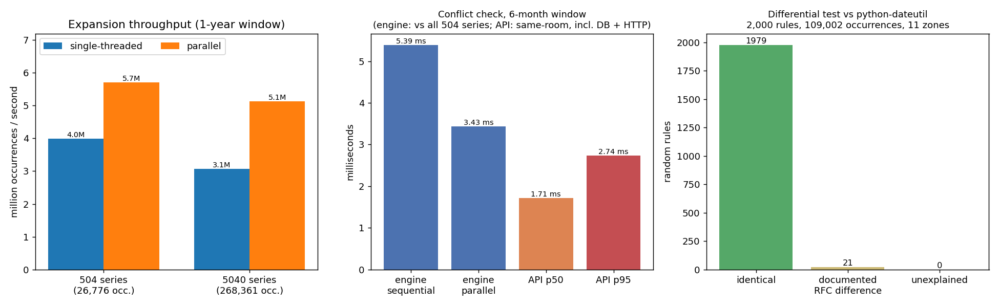

# Recurring Schedule Engine

I tested this recurrence engine against python-dateutil on 2,000 random rules in 11 time zones (109,002 occurrences), and it finished with zero unexplained mismatches. It's a C#/.NET 8 library and REST API that expands RFC 5545 recurring bookings (strings like `FREQ=WEEKLY;BYDAY=TU,TH`) into real instants, then tells a clinic or field-service scheduler which existing series a new booking would clash with. Through HTTP and PostgreSQL, a conflict check returns in 2.74 ms at p95.



## Trying it

```bash
docker compose up -d --build     # PostgreSQL + API on :25080, seeded with 504 clinic series
curl "localhost:25080/api/occurrences?from=2026-03-02T00:00:00Z&to=2026-03-09T00:00:00Z&resource=Toronto%20Room%20101"
curl -X POST localhost:25080/api/conflicts/check -H 'Content-Type: application/json' -d @examples/proposed_series.json
```

The first curl lists a week of bookings in one room. The second proposes Hand Therapy, Tuesdays and Thursdays at 10:00 for 90 minutes, in the same room, and returns every clash in the first quarter of 2026 with the overlapping minutes. If you look at the UTC times you can see the overlaps move by an hour after the 8 March DST change. That's the behaviour I wanted.

If Docker can't create bridge networks on your machine (some sandboxes and nested VMs can't), add the override: `docker compose -f docker-compose.yml -f docker-compose.hostnet.yml up -d --build`. Without Docker, run `scripts/dev-db.sh start` and then `Seed__File=$PWD/data/clinic_schedule.json dotnet run --project src/Rse.Api`, and the same curl commands work.

To run the tests, use `dotnet test`. The differential check is `python3 difftest/run_difftest.py --rules 2000 --fail-on-mismatch` and needs python-dateutil.

The endpoints are listed in [docs/api.md](docs/api.md).
The benchmark numbers and how to reproduce them are in [docs/benchmarks.md](docs/benchmarks.md).
What the tests cover is in [docs/testing.md](docs/testing.md).

## Time zones were the hard part

Expanding a rule is mostly bookkeeping. The expander walks years, months, weeks or days in steps of INTERVAL, builds the candidate days for each period, applies BYSETPOS and yields local wall-clock times lazily. Dates like 30 February just get skipped. Rules without COUNT can jump straight to the period containing the query window, so a 2030 query doesn't have to start counting from 2020.

The tricky part is turning those wall-clock times into UTC. A 09:00 clinic should stay at 09:00 local all year, so rules expand in local time first and only then get converted. A time that falls in a DST gap uses the offset from before the gap (02:30 becomes 03:30), and an ambiguous time in an overlap takes its first instance. Australia/Lord_Howe, which shifts by half an hour, broke my first assumptions and now has its own test. My favourite test is a Toronto series and a London series that only collide during the three weeks a year when the two zones' DST dates don't line up.

Conflict detection merges two lazy occurrence streams the same way merge sort merges two lists, always advancing whichever slot ends first. A pair of series costs time proportional to the occurrences inside the window and nothing outside it.

The differential harness generates seeded rules that go after the hard cases on purpose: start times inside gaps and overlaps, negative month days, ordinal weekdays, WKST with INTERVAL above 1, COUNT and UNTIL boundaries. 21 rules disagree with dateutil, all for one reason. For weekly rules with BYSETPOS, dateutil starts the first week at DTSTART, while I apply BYSETPOS to the whole WKST-aligned week, which is how I read the RFC. A mismatch only counts as explained if my output exactly matches dateutil run with the first week evaluated in full.

Parallel expansion helped less than I hoped. Each partition sorts its own series and a k-way merge combines them, but at 5,040 series it's only about 1.7 times faster than single-threaded on four cores. Most of what's left is allocating and copying result lists.

## Where it falls short

- No HOURLY, MINUTELY or SECONDLY rules, no BYHOUR, BYMINUTE, BYWEEKNO or BYYEARDAY, and no RDATE or iCalendar import. Each series has one start time per day.
- The conflict sweep assumes a series never overlaps itself, meaning the duration is shorter than the gap between its own occurrences.
- A date-only UNTIL includes the whole local day, where dateutil treats it as midnight.
- There's no authentication or caching. Stored series are read from PostgreSQL on every request, and I've only run the compose stack with the host-network override, not the default bridge setup.

Project period: 2026-06-08 to 2026-10-08.
